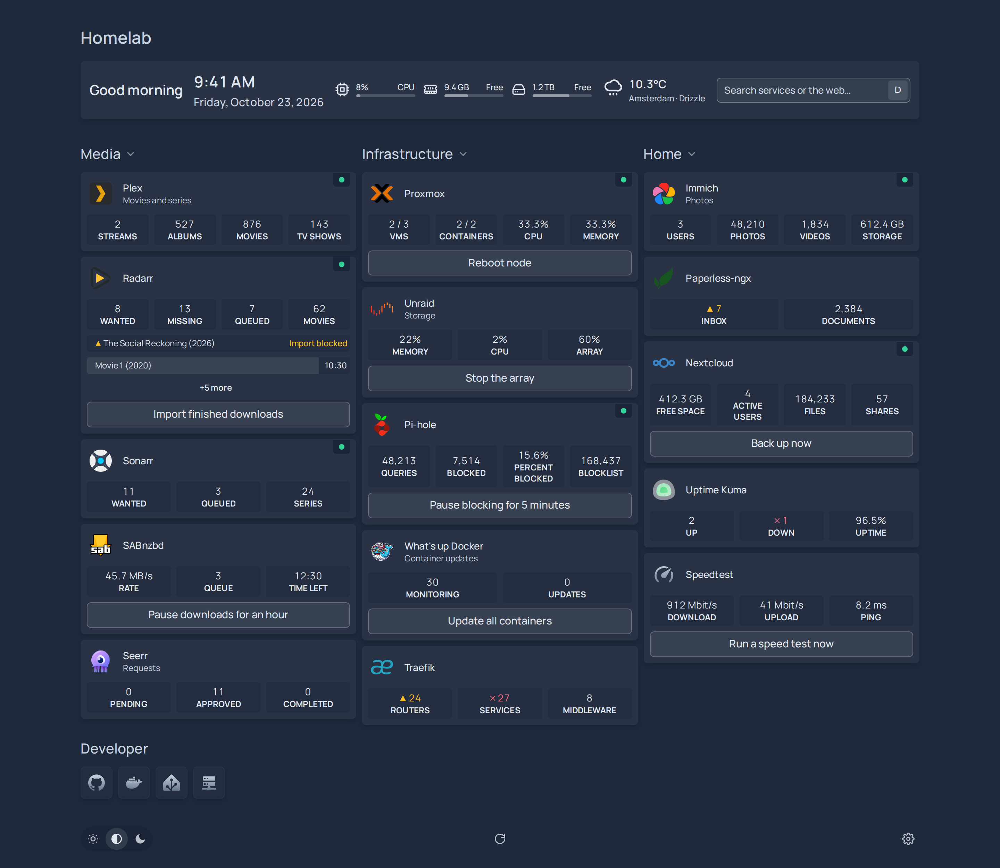

<div align="center">


<h1>Dashboard</h1>

<p>A fast, self-hosted start page for your homelab, configured in YAML,<br>
with 180+ widgets and room for the ones <strong>you</strong> publish.</p>

<picture>
  <source media="(prefers-color-scheme: light)" srcset="docs/images/screenshot-light.png">
  
</picture>

[Documentation](https://getdashboard.dev/) ·
[Widgets](https://getdashboard.dev/widgets/) ·
[Write a widget](https://getdashboard.dev/extend/)

</div>

## Features

- **180+ widgets** for the services you run: Radarr, Sonarr, Plex, Proxmox, Unraid, Pi-hole,
  Home Assistant, Immich and many more, installed and kept up to date by themselves.
- **Widgets anyone can publish**: a manifest and one function in your own git repository or npm
  package, added by others with one line of YAML.
- **YAML configuration** that reloads on save, with mistakes shown on the page.
- **Auto-discovery** from Docker labels and Kubernetes annotations.
- **Secrets stay on the server**: API keys never reach the browser.
- **homepage-compatible**: its config files, labels and `{{HOMEPAGE_VAR_*}}` variables work as they are.
- Dark and light themes, accent colours, tabs, 17 languages, installable as an app.

## Getting started

```bash
docker run -d -p 3000:3000 -v ./config:/config ghcr.io/stefanrenne/dashboard:latest
```

Or with Docker Compose:

```yaml
# compose.yaml
services:
  dashboard:
    image: ghcr.io/stefanrenne/dashboard:latest
    ports:
      - "3000:3000"
    volumes:
      - ./config:/config
    restart: unless-stopped
    healthcheck:                 # the image has the same one built in; here to tune it
      test: ["CMD", "wget", "-q", "-O", "/dev/null", "http://127.0.0.1:3000/api/health"]
      interval: 30s
      timeout: 5s
      retries: 3
      start_period: 20s
```
Open `http://localhost:3000` (or the machine's IP address), then edit the YAML files in `config`:
the page follows. To open it by a name (`dash.lan`, behind a reverse proxy), add that name under
[Allowed hosts](https://getdashboard.dev/configuration/#allowed-hosts) on the settings page.

## Compared

How Dashboard compares with other self-hosted start pages, as far as their own documentation says
(November 2026). Projects move quickly: check their sites before you decide.

| | Dashboard | [Homepage](https://gethomepage.dev) | [Homarr](https://homarr.dev) | [Dashy](https://dashy.to) | [Glance](https://github.com/glanceapp/glance) | [Homer](https://github.com/bastienwirtz/homer) |
|---|---|---|---|---|---|---|
| Configuration | YAML files, and a settings page in the browser | YAML files | In the browser (drag and drop), no YAML | YAML file, and an editor in the browser | YAML file | YAML file |
| Setup wizard on first start | ✓ (finds running containers) | – | ✓ (onboarding in the browser) | – | – | – |
| Service widgets | 180+, in a separate collection | 100+ | 90+ | 50+ | about 30 widget types, plus a custom API widget | a few dozen "smart cards" |
| Widgets from third parties | ✓ packages from git, npm or a folder, sandboxed | – (custom API widget) | – | – (custom widgets in the config) | – (custom API and extension widgets) | – |
| Docker discovery | ✓ labels, also homepage's | ✓ labels | containers as an integration | – | containers widget | – |
| Kubernetes discovery | ✓ Ingress, IngressRoute and HTTPRoute | ✓ Ingress annotations | Kubernetes as an integration | – | – | – |
| Login | admin password and passkeys, for the settings and actions or the whole page | password or OIDC | users, OIDC and LDAP, with permissions | users, Keycloak or OIDC | users with passwords | – (behind a proxy) |
| Buttons that run something | ✓ scripts, commands and webhooks, with confirmation | – | ✓ controls for some integrations | – | – | – |
| Reads homepage's config | ✓ as is, and imports it | (its own) | – | – | – | – |
| Live check of edited YAML | ✓ with line numbers, before saving | – | (no YAML) | ✓ schema check in the editor | – | – |
| Quick launch / search | ✓ | ✓ | ✓ | ✓ | ✓ search widget | ✓ |
| Install as an app (PWA) | ✓ | ✓ | – | – | – | ✓ |
| Languages | 17 | many (community translations) | 26 | many | – | – |
| Backend | Node.js, one dependency, no database | Next.js | Next.js with a database | Vue with a Node server | Go, a single binary | none (static files) |

"–" means the project's documentation does not mention it, not always that it is impossible.

## Documentation

Everything else is on **[getdashboard.dev](https://getdashboard.dev/)**:
[configuration](https://getdashboard.dev/configuration/),
[every widget](https://getdashboard.dev/widgets/) and how to
[write your own](https://getdashboard.dev/extend/).
The same pages are in [docs/](docs/README.md).

## License

[MIT](LICENSE)
