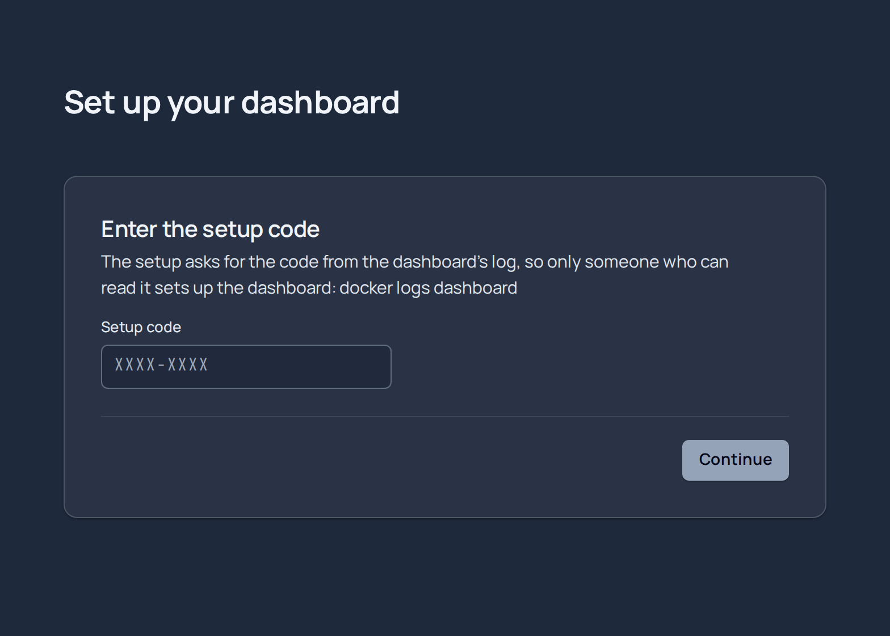
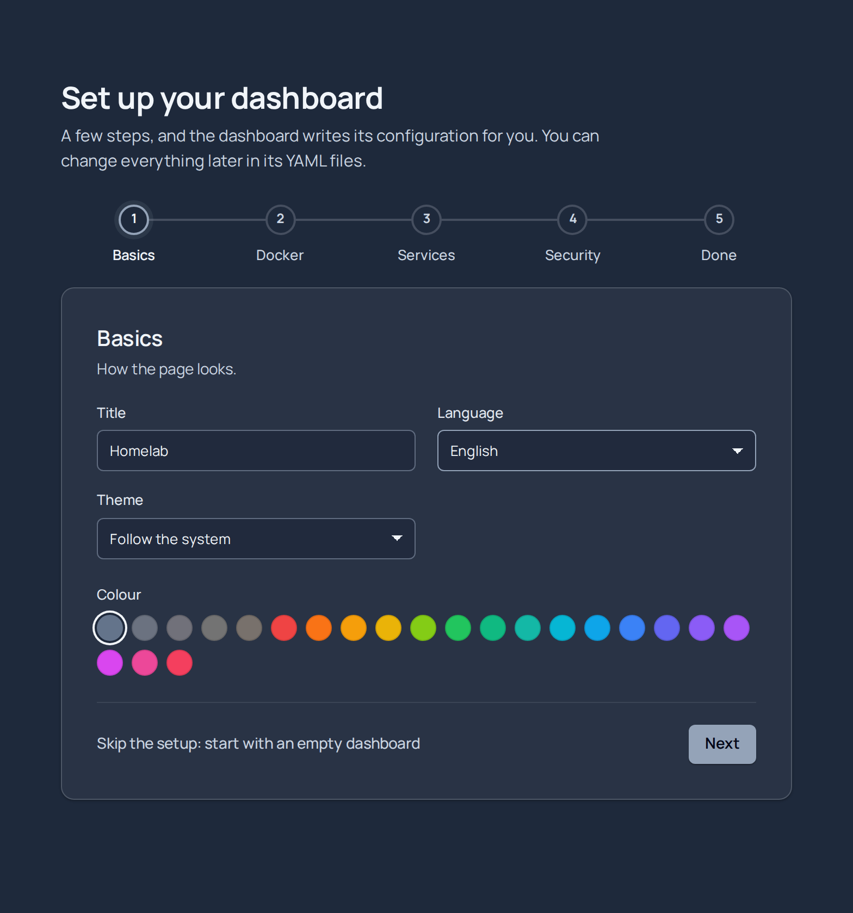
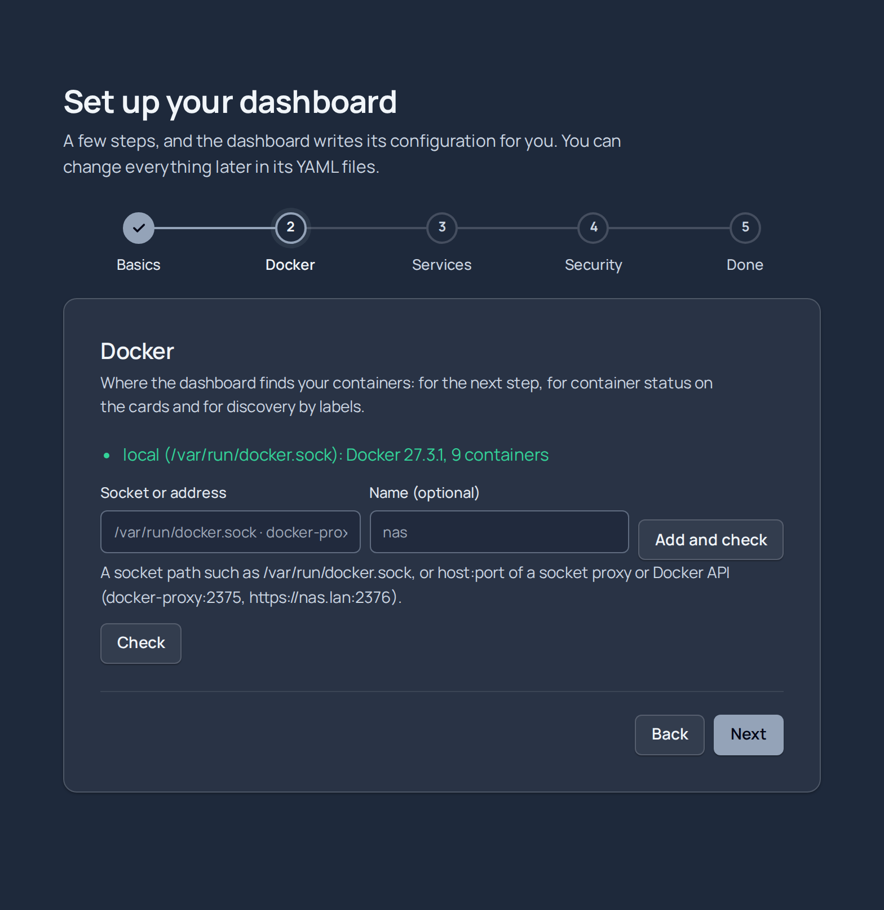
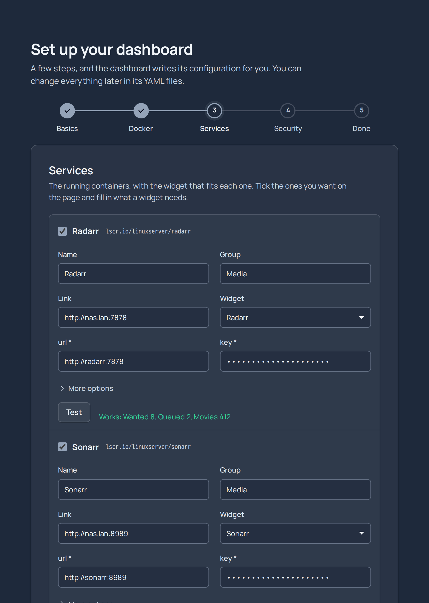
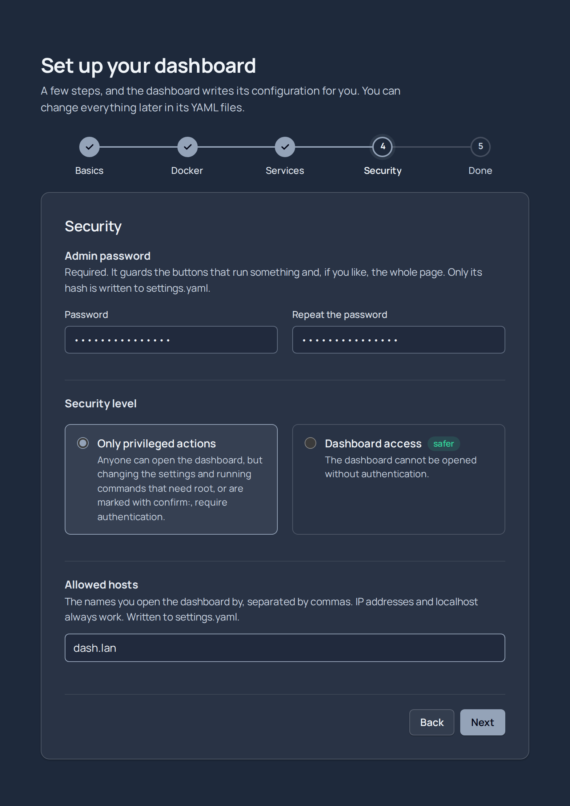
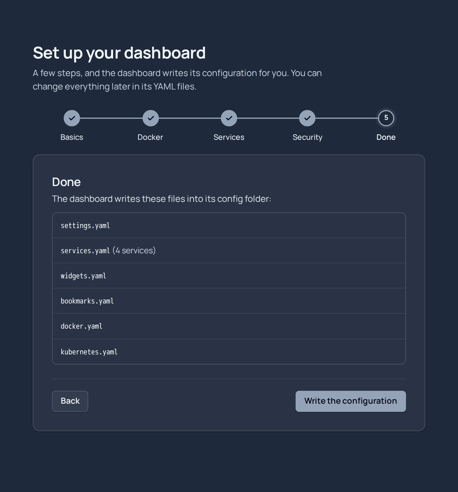
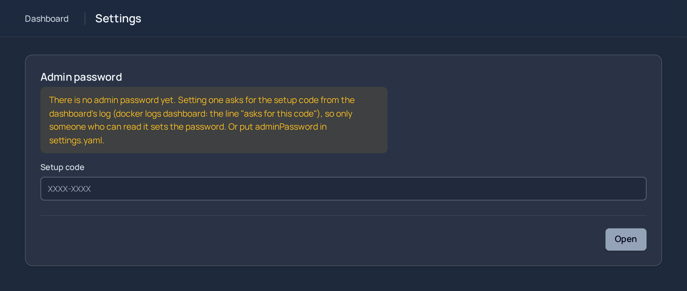

# First start

On a first start, with an empty config folder, the dashboard opens a setup wizard. In five steps
it writes a working configuration: a title and colour, the Docker servers it can reach, a card with
the right widget for each container you tick, and an admin password. Everything it writes is plain
YAML that you can change later, on the [settings page](README.md#settings-page) or in the files
themselves.

## Before you start

Start the container with an empty folder for `/config`. The Docker socket is optional, but it lets
the wizard find your containers:

```yaml
# compose.yaml
services:
  dashboard:
    image: ghcr.io/stefanrenne/dashboard:latest
    container_name: dashboard
    ports:
      - 3000:3000
    volumes:
      - ./config:/config
      - /var/run/docker.sock:/var/run/docker.sock:ro   # optional: to find your containers
    restart: unless-stopped
```

The image sees that `/config` is empty, writes the marker file `.onboarding` there, and the page
opens at `/setup` until the wizard is done. A safer way to give it Docker is a socket proxy that
only allows reading containers: see [Docker](docker.md).

## The setup code



The wizard first asks for a code that the dashboard writes in its log when it starts:

```bash
docker logs dashboard 2>&1 | grep "asks for this code"
# first start: open http://<this server>:3000/setup to set up the dashboard; it asks for this code: K7QM-3XWD
```

It asks for it everywhere, also on your own network: an address alone does not prove who you are,
since a reverse proxy, a tunnel or Docker's own port forwarding can make a visitor from the
internet look local, and whoever finishes the wizard sets the admin password. Wrong codes are
slowed down. The code is new at every start of the container; a correct one is remembered by your
browser until the wizard is done.

## 1. Basics



The page's title, its language, light, dark or following the system, and its colour. They go into
[`settings.yaml`](settings.md). **Skip the setup** leads straight to the security step and writes a
configuration without services.

## 2. Docker



The Docker servers the dashboard can reach: a mounted socket, or `docker.yaml` once there is one.
Each shows its version and its number of containers, or the error it got. A socket it may not use
gets a hint: start the container as root (the default) or use a socket proxy.

Add another server with its socket path, or the `host:port` of a socket proxy or Docker API (`nas`
is the name it gets in `docker.yaml`); it is checked at once. What you add is written to
[`docker.yaml`](docker.md), with the mounted socket. Without any server, the next step only offers
services you add by hand.

## 3. Services



The running containers of those servers, each with the widget that fits its image
(`linuxserver/radarr` gets `radarr`) and its address:

- the container's name, when it shares a network with the dashboard (`http://radarr:7878`);
- its own address, on a macvlan or ipvlan network (Unraid's `br0`);
- or the published port on the server.

Tick the ones you want on the page and fill in what their widget needs (marked `*`, usually a `key`).
**Test** asks the service at once and shows what it answers. **Next** checks every ticked service:
a name, a link, the widget's required options and a test; one that fails is marked in red with its
error, and the wizard stays until it is fixed or unticked.

A key you type is written into `services.yaml` as it is. To keep it out of the file, type
`{{DASHBOARD_VAR_RADARR_KEY}}` instead and set that variable on the container (see
[Variables](README.md#variables)).

- Containers with `dashboard.*` labels are on the page already ([discovery](docker.md)): they are
  shown, not ticked.
- **Add a service by hand** adds one without a container.
- **Migrate from homepage** takes homepage's `services.yaml`, `settings.yaml`, `bookmarks.yaml`,
  `widgets.yaml` and `docker.yaml`, shows what carries over and which widgets have no match, and
  writes them as they are in place of what the wizard would write. See
  [From homepage](homepage.md).

## 4. Security



- **Admin password**: required, at least 8 characters; only its hash is written. It guards the
  settings page, buttons that run something and, if you like, the whole page. See
  [Admin password](README.md#admin-password).
- **Security level**: *Only privileged actions* leaves the page open and asks the password for the
  settings and for presses that need it; *Dashboard access* shows a
  [login page](README.md#login-page) first. Choose the second when the dashboard can be reached
  from outside your home.
- **Allowed hosts**: the names you open the dashboard by. Opened by a name (`dash.lan`, or the
  address of your reverse proxy), the wizard fills that name in; opened by an IP address, the field
  stays empty. IP addresses and `localhost` always work; any other name gets a refusal once the
  wizard is done, until it is added here or on the settings page. See [Allowed hosts](README.md#allowed-hosts).

## 5. Done



**Write the configuration** writes `settings.yaml`, `services.yaml`, `widgets.yaml` (the time, the
system's resources and a search box), `bookmarks.yaml`, `docker.yaml` and `kubernetes.yaml`, removes
`.onboarding` and opens the dashboard. It writes nothing when one of those files is there already.

From then on, `/setup` is gone. Change things on the settings page (the gear in the footer), or in
the files: the page follows every save.

## A dashboard without an admin password

A dashboard set up before the wizard existed, or from files of your own, may have no admin
password. The settings page then asks for the setup code first, as the wizard does, and then for
the password; nothing else can be changed before it is set.



```bash
docker logs dashboard 2>&1 | grep "asks for this code"
# no admin password yet: http://<this server>:3000/settings asks for this code to set one: K7QM-3XWD
```

Or put the password's hash in `settings.yaml` yourself (`adminPassword`, see
[Admin password](README.md#admin-password)).

## When something goes wrong

| What you see | What to do |
|---|---|
| The code is refused | Take the newest line from the log: a restart makes a new code. After a few wrong tries the wizard asks you to wait. |
| No Docker server in step 2 | Mount the socket (`/var/run/docker.sock`) or add a socket proxy's address. A "permission denied" means the container cannot use the socket: start it as root (the default) or use a proxy. |
| A container has no widget | Not every image is recognised: pick the widget yourself, or leave it without one (a plain link). |
| A test fails | The error says why: a wrong key, an address the dashboard cannot reach from its container (try the container's name on a shared network, or the server's address and published port). |
| You want the wizard again | Stop the container, empty the config folder, and start it again. |
